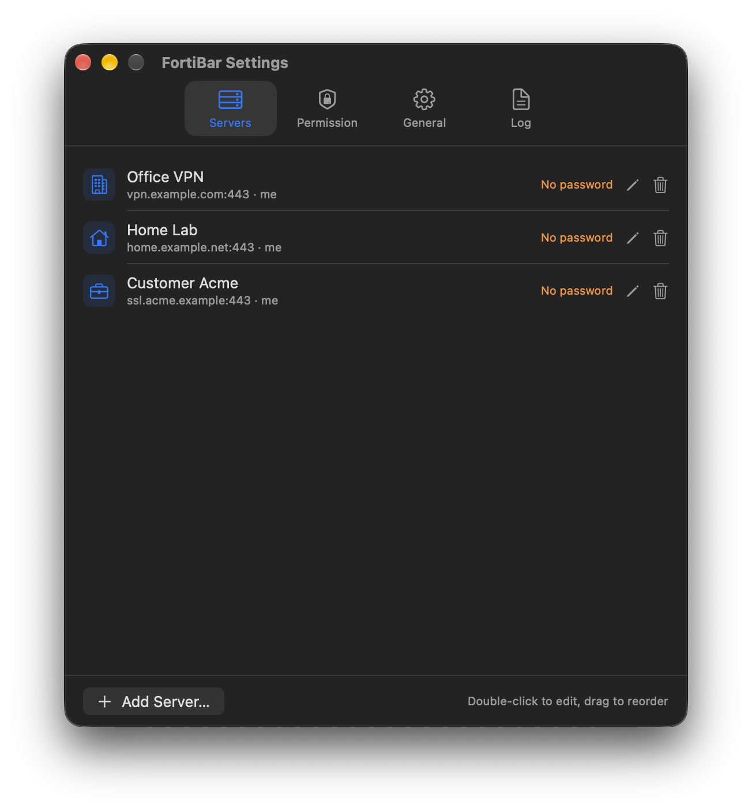
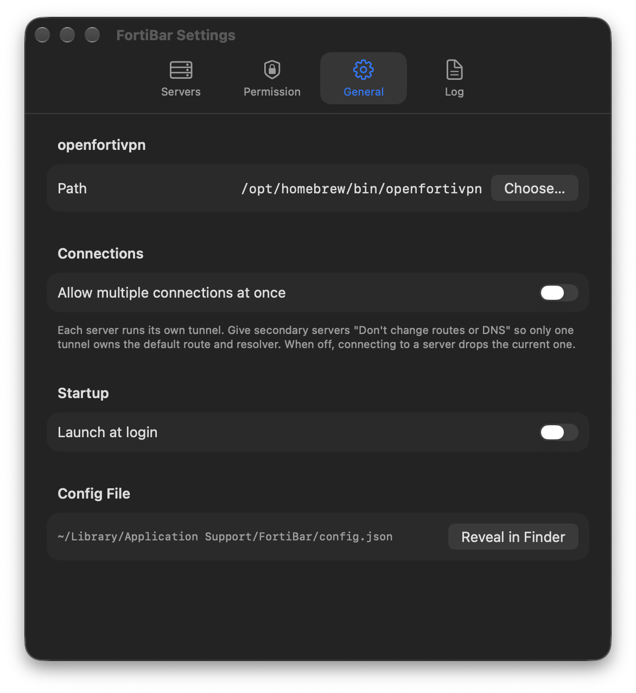
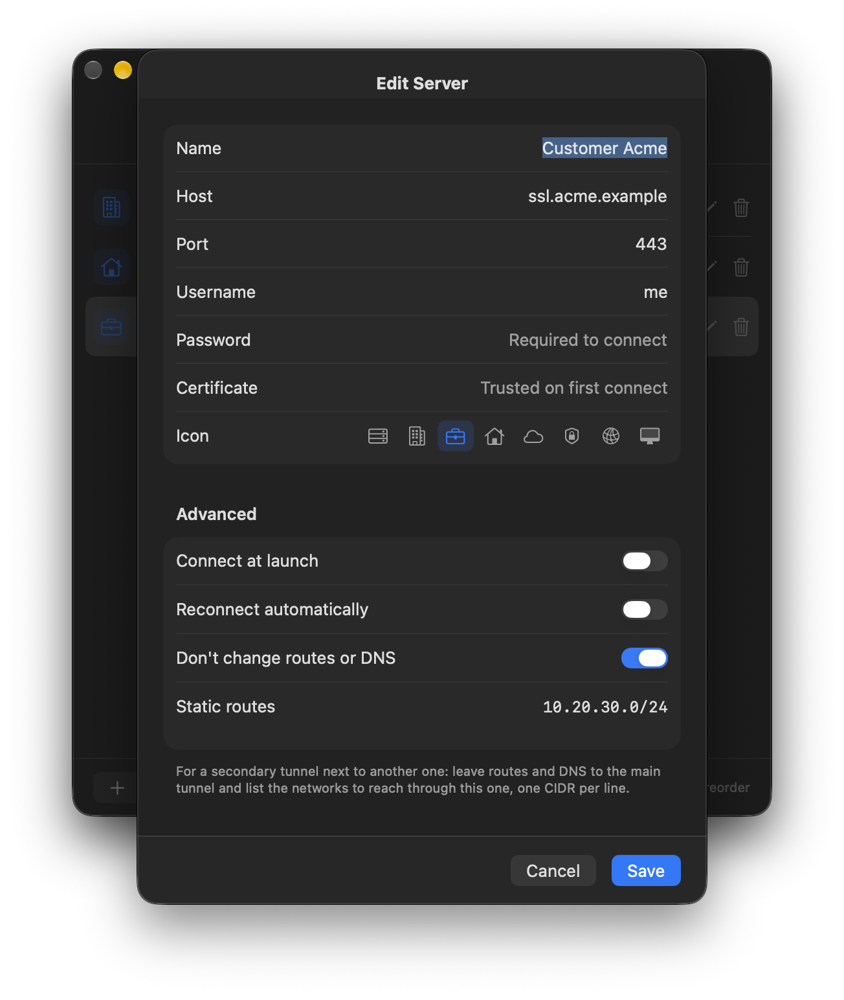

# FortiBar


> **FortiBar** is a macOS menu bar FortiVPN client for several simultaneous tunnels (via [openfortivpn](https://github.com/adrienverge/openfortivpn)), with auto-reconnect and a CLI.
>
> It is inspired by and forked from [OpenFortiMac](https://github.com/rempairamore/OpenFortiMac) by [@rempairamore](https://github.com/rempairamore), and is released under the same GPL-3.0 license. Many thanks to the original author. This project is not affiliated with Fortinet.
>
> See [Attribution](#attribution) and [Upgrading from OpenFortiMac](#upgrading-from-openfortimac).

Connect with one click from the menu bar, run several tunnels side by side, reconnect automatically when one drops. Passwords are stored in the macOS Keychain. Website: [romanvassilchenko.github.io/FortiBar](https://romanvassilchenko.github.io/FortiBar/).


<p>



</p>

## Installation

### Homebrew (recommended)

```bash
brew trust romanvassilchenko/tap
brew install --cask romanvassilchenko/tap/fortibar
```

This installs FortiBar and [openfortivpn](https://formulae.brew.sh/formula/openfortivpn) from the [romanvassilchenko/homebrew-tap](https://github.com/RomanVassilchenko/homebrew-tap) tap and links the `fortibar` command. Homebrew asks you to trust third-party taps once, which is what the first line does. Update with `brew upgrade --cask fortibar`: it quits FortiBar (closing its tunnels), so start it again afterwards.

### Download

1. Install openfortivpn: `brew install openfortivpn`
2. Download the latest `.dmg` from [Releases](https://github.com/RomanVassilchenko/FortiBar/releases/latest), open it and drag **FortiBar** to Applications.

### Build it yourself

Requires Xcode 26 or later.

```bash
brew install openfortivpn
git clone https://github.com/RomanVassilchenko/FortiBar.git
cd FortiBar
./build_dmg.sh        # produces FortiBar_vX.Y.Z.dmg
```

Without a code signing certificate named `FortiBar Self-Signed` in your keychain the app is signed ad hoc, and macOS asks for Keychain access again after every rebuild. Create one in Keychain Access → Certificate Assistant to keep the app's identity stable.

### First launch

Releases are signed with a self-signed certificate and are not notarized by Apple, so macOS blocks the first launch. Open **System Settings → Privacy & Security**, scroll down and click **Open Anyway** next to the FortiBar message. This is needed only once.

### Allow openfortivpn to run as root

openfortivpn needs root to create the tunnel. On first launch FortiBar opens **Settings → Permission**: click **Set Up…** and enter your administrator password once. The app writes this rule to `/etc/sudoers.d/fortibar` (validated with `visudo`, owned by root, read-only):

```
YOUR_USERNAME ALL = (root) NOPASSWD: /opt/homebrew/bin/openfortivpn
```

If a server uses static routes, the rule also allows `/sbin/route`, limited to network routes through ppp interfaces. **Remove** in the same place deletes the rule.

> **Security note:** with this rule any process running as your user can start openfortivpn as root without a password, and `/opt/homebrew` is writable by your user. This is the usual trade-off for openfortivpn GUIs; remove the rule if you stop using the app.

<details>
<summary>Manual setup</summary>

```bash
sudo visudo -f /etc/sudoers.d/fortibar
```

Add this line, with your macOS username and the output of `which openfortivpn` (`/opt/homebrew/bin/openfortivpn` on Apple Silicon, `/usr/local/bin/openfortivpn` on Intel):

```
YOUR_USERNAME ALL = (root) NOPASSWD: /opt/homebrew/bin/openfortivpn
```

For static routes add:

```
YOUR_USERNAME ALL = (root) NOPASSWD: /sbin/route -n add -net * -interface ppp*, /sbin/route -n change -net * -interface ppp*, /sbin/route -n delete -net * -interface ppp*
```
</details>

## Usage

Click the shield in the menu bar → **Settings** (⌘,) → **Servers** → add your VPN servers.

The menu bar icon follows the menu bar appearance like system icons: an outlined shield when disconnected, a checkmark when one tunnel is up, the number of tunnels when several are.

Click it to open the panel: a status card per tunnel (connection time, tunnel IP, **Disconnect** ⌘D), the server list (hover a server and click **Connect**; a server without a saved password opens its editor) and a footer with Add server, Settings, Log and Quit. Right-click the icon for a quick menu. FortiBar sends a notification on connect, disconnect and errors.

### Multiple connections

Turn on **Settings → General → Allow multiple connections at once** to run several tunnels side by side. When it is off (the default), connecting to a server drops the current one.

Only one tunnel should own the default route and DNS. In the server editor → **Advanced**:

- **Don't change routes or DNS** runs openfortivpn with `--no-routes --no-dns` (use it for secondary tunnels).
- **Static routes**: CIDRs, one per line, routed through this tunnel's ppp interface while it is up. Needs the route permission: the panel shows an **Update** banner when it is missing.
- **Connect at launch**: connect when FortiBar starts.
- **Reconnect automatically**: when the tunnel drops (network change, sleep, gateway timeout), retry after 2, 5, 10, 20, 30, then every 60 seconds until you disconnect. While offline it waits for the network. Wrong credentials or a certificate error stop the retries.

Quitting FortiBar (⌘Q, logout or `SIGTERM`) disconnects every tunnel first, so openfortivpn restores routes and DNS.

### Command line

The app executable doubles as a command line tool. Homebrew links it as `fortibar`; with the DMG, link it into your `PATH`:

```bash
ln -s /Applications/FortiBar.app/Contents/MacOS/FortiBar /opt/homebrew/bin/fortibar
```

```bash
fortibar list                     # servers and their state
fortibar status [--json]          # active tunnels: time, IP, ppp interface, routes
fortibar connect office           # name, unique prefix or id; waits until up
fortibar disconnect office        # or: disconnect --all
fortibar logs -f                  # openfortivpn output

fortibar add "Branch" --host vpn.example.com --port 10443 --user me --password \
    --no-routes-dns --route 10.20.30.0/24
fortibar edit branch --add-route 10.40.0.0/16 --auto-connect --auto-reconnect
fortibar show branch
fortibar remove branch --yes      # also deletes the saved password
fortibar settings --allow-multiple on
fortibar permission update        # reinstall the sudo rule (admin dialog)
```

`fortibar help` lists every option. Commands run through the app (started in the background if needed), which owns the tunnels, the Keychain and the sudo rule. Passwords are read with `--password` (prompt) or `--password-stdin`, never from arguments.

## Configuration

Servers and settings live in `~/Library/Application Support/FortiBar/config.json`, the log in `~/Library/Logs/FortiBar`. Edit them in Settings or by hand:

```json
{
    "servers": [
        {
            "id": "office-1",
            "name": "Office VPN",
            "host": "vpn.company.com",
            "port": 443,
            "username": "john.doe"
        }
    ],
    "openfortivpn_path": "/opt/homebrew/bin/openfortivpn"
}
```

Optional fields, written only when used:

| Field | Where | Meaning |
|-------|-------|---------|
| `allow_multiple_connections` | top level | Run several tunnels at once (default `false`) |
| `trusted_cert` | server | SHA-256 digest of the pinned gateway certificate (see below) |
| `no_routes_dns` | server | Pass `--no-routes --no-dns` (default `false`) |
| `static_routes` | server | CIDRs routed through the tunnel, e.g. `["10.20.30.0/24"]` |
| `auto_connect` | server | Connect when FortiBar starts (default `false`) |
| `auto_reconnect` | server | Reconnect when the tunnel drops (default `false`) |

Passwords are never stored in this file; they live in the Keychain.

### Certificate pinning

You do not need to fill in `trusted_cert`. When a gateway's certificate cannot be verified (self-signed or an internal CA), the first connection trusts it, saves its digest and connects. From then on only that certificate is accepted. To trust a renewed certificate, clear the field (server editor → Certificate, or `fortibar edit <server> --no-cert`); the next connection pins the new one.

## Troubleshooting

- **"openfortivpn not found"**: check the path in Settings → General against `which openfortivpn`.
- **"Administrator permission not set up"**: the sudo rule is missing or points to another openfortivpn. Settings → Permission → **Set Up…** (or **Update…**).
- **"FortiBar is damaged" / "cannot be opened"**: see [First launch](#first-launch).
- **"Certificate error"**: the gateway presents a different certificate than the pinned one. If it was renewed, clear the server's Certificate field. Otherwise do not connect: someone may be intercepting the traffic.
- **Connection fails**: Settings → Log shows the openfortivpn output.

## Uninstall

With Homebrew:

```bash
brew uninstall --cask fortibar          # also removes /etc/sudoers.d/fortibar (asks for your password)
brew uninstall --cask --zap fortibar    # also deletes settings and logs
```

Manually:

1. Settings → Permission → **Remove**, then quit FortiBar.
2. `rm -rf /Applications/FortiBar.app ~/Library/Application\ Support/FortiBar ~/Library/Logs/FortiBar`
3. Delete the saved passwords in Keychain Access (service `com.romanvassilchenko.FortiBar.vpn`).

## Upgrading from OpenFortiMac

FortiBar has its own bundle identifier, so it installs next to OpenFortiMac. Quit OpenFortiMac and start FortiBar once; it migrates your data:

- **Servers, settings and logs** move from the `OpenFortiMac` folders in `~/Library/Application Support` and `~/Library/Logs`.
- **Passwords** are copied to FortiBar's Keychain service and removed from the old one. If macOS asks whether FortiBar can use the old items, choose **Always Allow** (a refusal is retried on the next launch).
- **The sudo rule**: open Settings → Permission → **Update…**; one administrator prompt installs `/etc/sudoers.d/fortibar` and removes `/etc/sudoers.d/openfortimac`. A rule you wrote by hand (for example `/etc/sudoers.d/openfortivpn`) is left alone: delete it with `sudo rm`.
- **Launch at login** must be turned on again in FortiBar's Settings (remove OpenFortiMac from System Settings → General → Login Items).
- **The CLI** is now `fortibar` instead of `openfortimac`: update symlinks and scripts.

Then delete `/Applications/OpenFortiMac.app`.

## Releasing

Bump `MARKETING_VERSION` in Xcode and add a `## vX.Y.Z` section to `CHANGELOG.md`. When `main` gets a version that has no tag yet, the [Release workflow](.github/workflows/release.yml) runs `./build_dmg.sh` to build a universal DMG signed with the "FortiBar Self-Signed" certificate, attests the build provenance, scans it on VirusTotal and publishes the `vX.Y.Z` release with the changelog section as notes, then updates the cask in [homebrew-tap](https://github.com/RomanVassilchenko/homebrew-tap) through a pull request that it merges once `brew style` and `brew audit` pass. Pushing a tag with a suffix (`v1.4.0-rc.1`) publishes a pre-release and skips Homebrew; pull requests only build the DMG.

Repository secrets: `SIGNING_CERT_P12`, `SIGNING_CERT_PASSWORD`, `VIRUSTOTAL_API_KEY`, `HOMEBREW_TAP_TOKEN` (fine-grained token with Contents and Pull requests write access to `homebrew-tap` only); variable `EXPECTED_CERT_SHA1`. Keep a backup of the `.p12`: a new certificate changes the app's identity and macOS asks for Keychain access again.

Tests: `xcodebuild test -project FortiBar.xcodeproj -scheme FortiBar -destination 'platform=macOS'`. The demo GIF is generated with `python3 scripts/make_panel_demo.py` (needs ffmpeg).

## Attribution

FortiBar is a fork of [OpenFortiMac](https://github.com/rempairamore/OpenFortiMac) by [@rempairamore](https://github.com/rempairamore). The original work is copyright its author and licensed under the GNU General Public License v3.0; this project is distributed under the same license (see [LICENSE](LICENSE)), and all original copyright and license notices are retained. FortiBar wraps [openfortivpn](https://github.com/adrienverge/openfortivpn) by Adrien Vergé. FortiBar is not affiliated with Fortinet.
